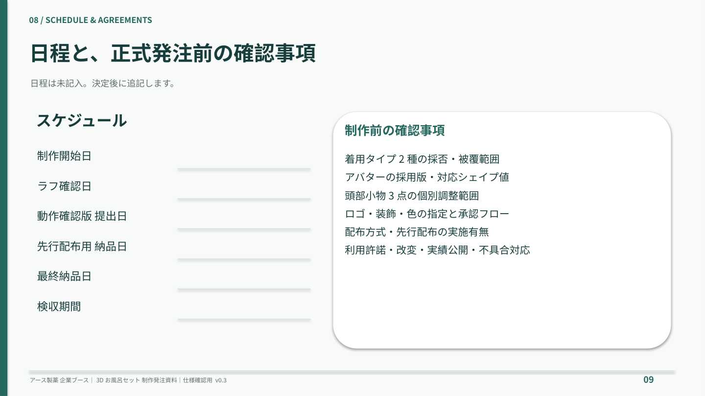
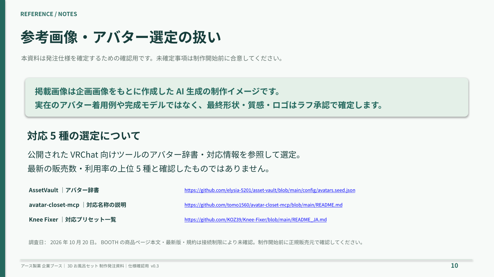

# 3Dお風呂セット 制作発注スライド

バーチャルマーケット／アース製薬 企業ブース｜仕様確認用 v0.3

- [編集用PowerPoint](bath-set-production-slides.pptx)
- [閲覧用PDF](bath-set-production-slides.pdf)

以下で全10枚を閲覧できます。画像をクリックすると拡大表示できます。

掲載画像はAI生成の制作イメージです。バスタブは対象外、納期欄は空欄です。対応アバターは、しなの・マヌカ・萌・ライム・桔梗。最新の人気上位5種と確認したものではなく、参照資料と確認範囲は最終ページに記載しています。

## 01．表紙

## 02．制作対象4アイテム

## 03．頭部小物の仕様

## 04．キュウリの目パック

## 05．バスタオルの仕様

## 06．対応アバター5種

## 07．納品物・技術条件

## 08．制作工程・検収

## 09．日程・発注前の確認事項

## 10．参考情報・選定資料

