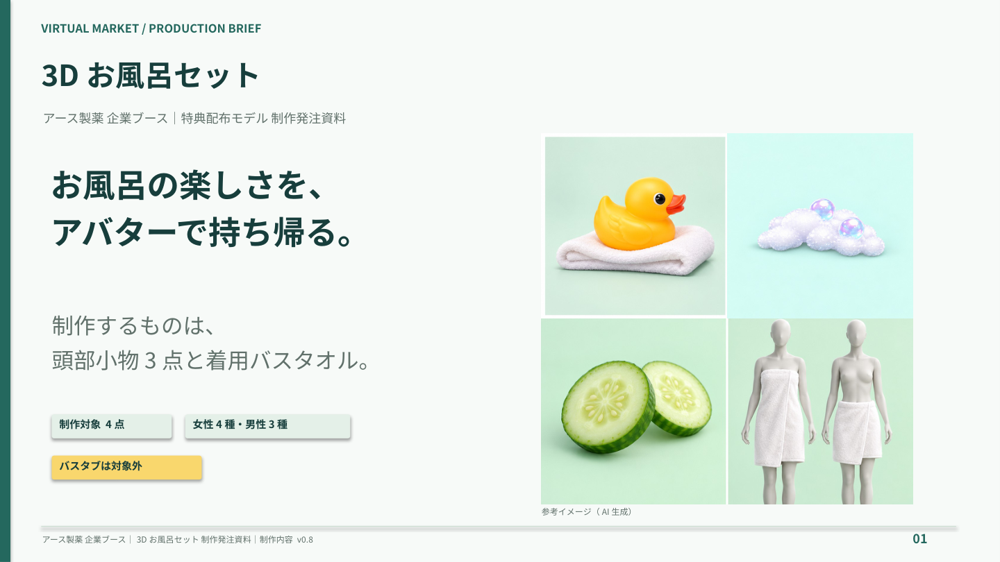
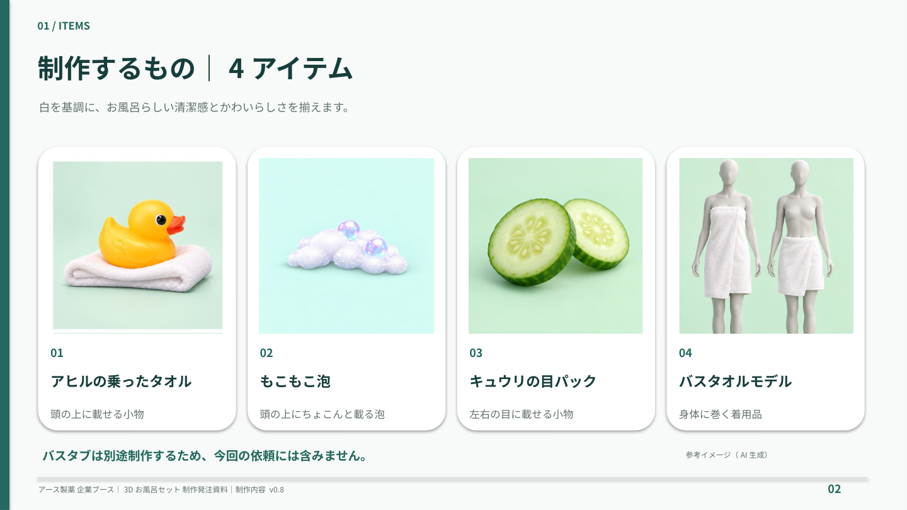
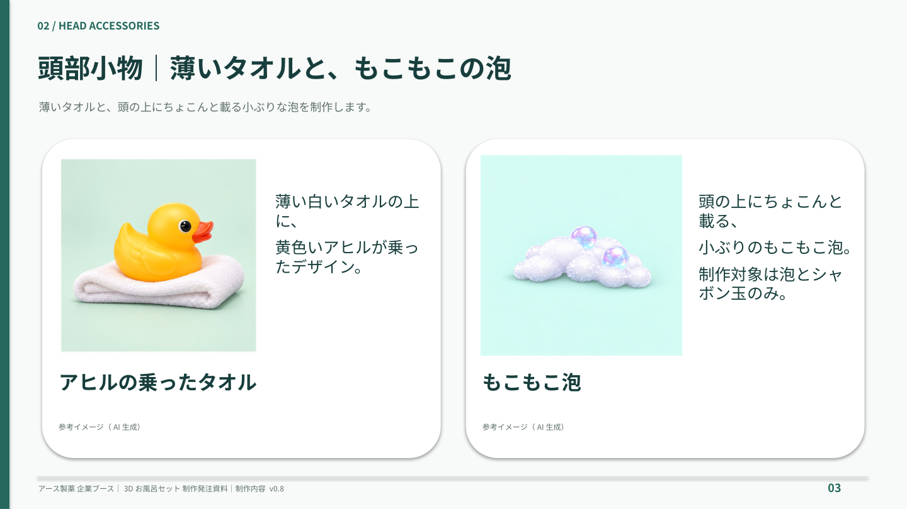
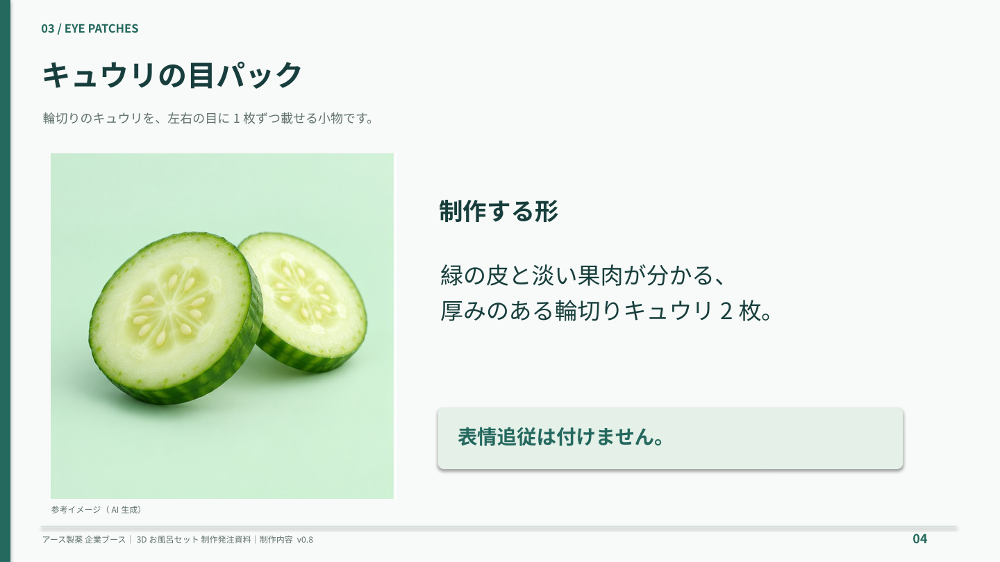
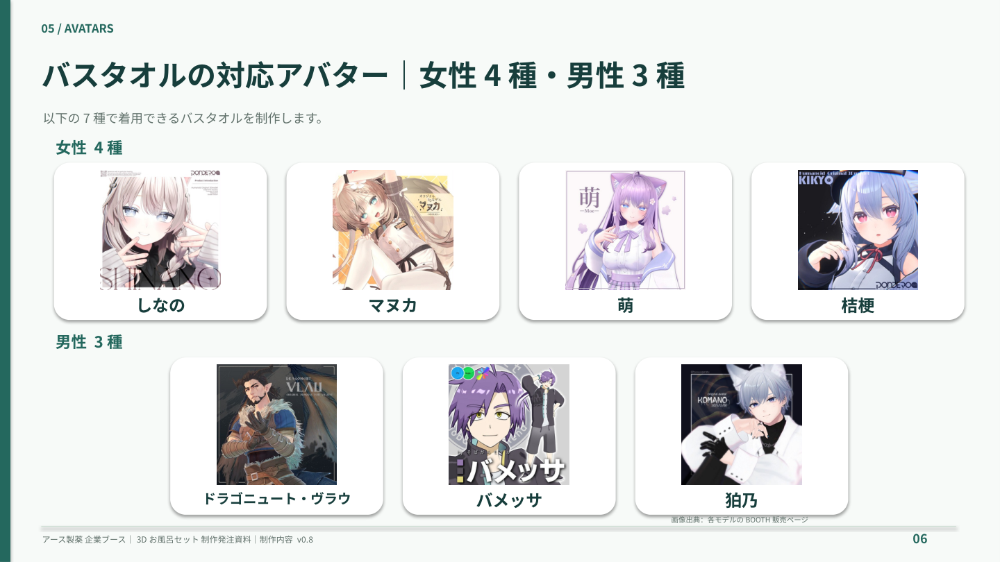
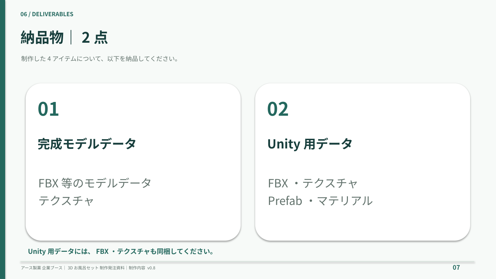
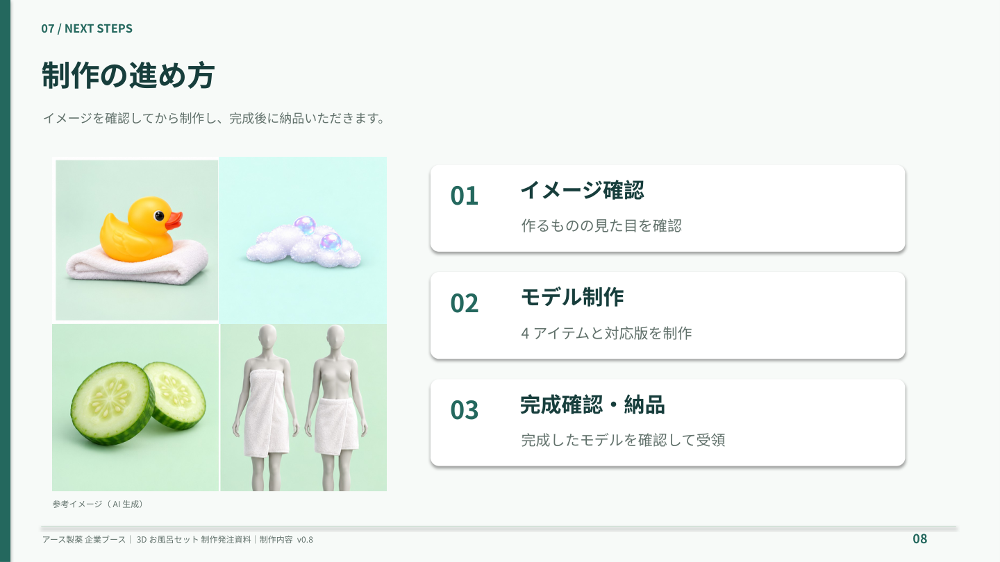

# 3Dお風呂セット 制作発注スライド

バーチャルマーケット／アース製薬 企業ブース｜全8枚｜v0.8

- [編集用PowerPoint](bath-set-production-slides.pptx)
- [閲覧用PDF](bath-set-production-slides.pdf)

各画像をクリックすると拡大できます。「もこもこ泡」は頭の上に載る小ぶりな形です。参考画像は泡とシャボン玉のみを表示しています。小物の画像はAI生成の参考イメージです。アバター画像は各モデルの販売ページを参照しています。

## 01．表紙

## 02．制作する4アイテム

## 03．薄いタオルと、もこもこの泡

## 04．キュウリの目パック

## 05．バスタオル

## 06．女性4種・男性3種の対応アバター

## 07．納品物2点

## 08．制作の進め方

アバター画像の出典

販売ページの公開商品画像を、対応対象の識別用に参照しています。画像の権利は各権利者に帰属します。

- [しなの](https://booth.pm/ja/items/6106863)
- [マヌカ](https://booth.pm/ja/items/5058077)
- [萌](https://booth.pm/ja/items/4667400)
- [桔梗](https://booth.pm/ja/items/3681787)
- [ドラゴニュート・ヴラウ](https://booth.pm/ja/items/4169438)
- [バメッサ](https://booth.pm/ja/items/5129599)
- [狛乃](https://booth.pm/ja/items/5260363)

確認日：2026年10月21日。対応アバターは発注者指定の7種です。

